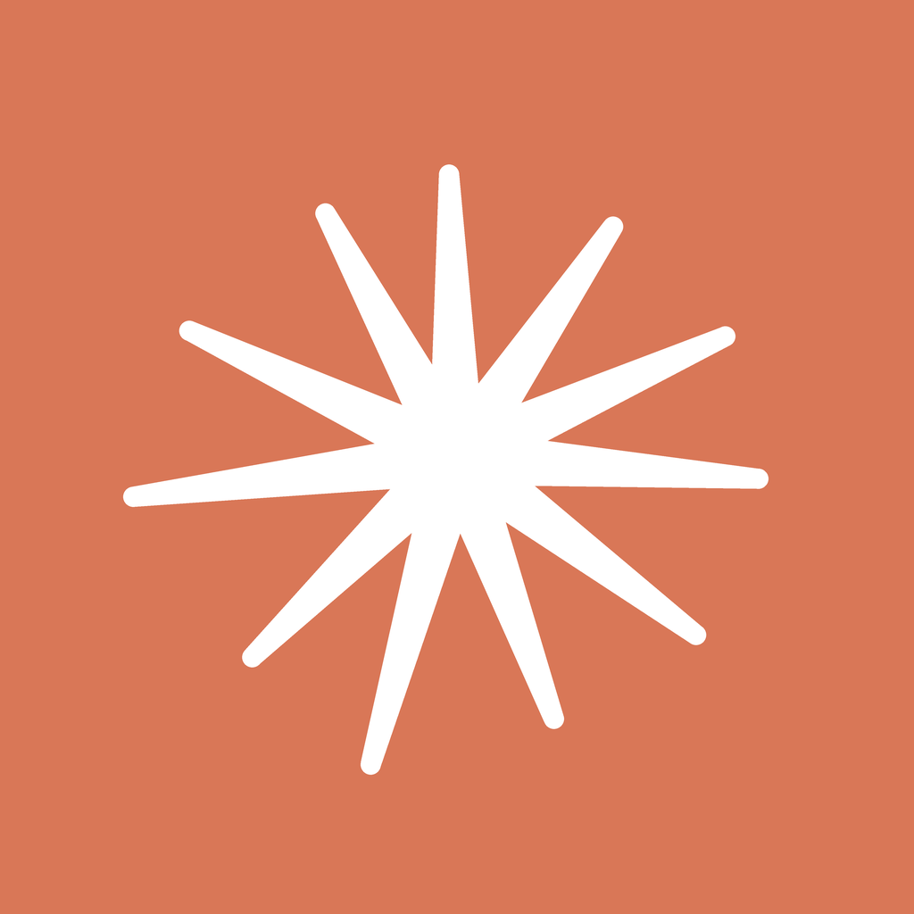

<p align="center">
  
</p>

# Talkit

**A free, open source speech-to-text keyboard for iPhone that runs entirely on your phone.**

Talkit is a hold-to-talk keyboard. Hold the bar, speak, let go, and your words are typed into whatever app you're using: WhatsApp, Messages, Notes, Mail. The speech model runs on the iPhone's Neural Engine, so your voice never leaves the phone.

The same engine also runs on the Mac as a local transcription server, so desktop dictation apps can use it too.

## Why Talkit?

- **Private**: your voice stays on your phone. No account, no server, no audio upload
- **Fast to use**: hold, talk, let go. No popups, no app switching, no copy and paste
- **Open source**: about 700 lines of Swift. Read all of it in one sitting
- **Simple**: one tool, one job. Turn what you say into text where your cursor is

## How It Works

1. **Switch** to the Talkit keyboard with the 🌐 globe key, in any app
2. **Hold** the bar and speak
3. **Let go**, and Talkit transcribes your speech with NVIDIA Parakeet
4. **Get** the text typed in place, right where your cursor is

The process is entirely local:

- Transcription uses **Parakeet TDT 0.6B v3** (English and 24 other European languages), converted to Core ML by [FluidAudio](https://github.com/FluidInference/FluidAudio)
- It runs on the **Apple Neural Engine**, the chip in every recent iPhone and Mac built for exactly this kind of work
- The model downloads once (about 460 MB) and is then kept in memory, so there's no load wait when you speak

### Why the Neural Engine

On the Mac, the same model on the same 20 recordings took 6.49 s on the GPU and 1.84 s on the Neural Engine, about 3.5 times faster. The full experiment is in [this write-up](https://medium.com/@hellorahulk/your-mac-has-a-chip-built-for-ai-most-local-ai-tutorials-skip-it-bf367c1b5c7a). iPhone numbers aren't measured yet.

## Quick Start

### iPhone

You need a Mac with Xcode, and an Apple ID signed in under **Xcode → Settings → Accounts** (a free one works).

1. Plug in your iPhone, tap **Trust**, and turn on **Settings → Privacy & Security → Developer Mode**
2. Clone this repo and run:
   ```bash
   ios/install-to-iphone.sh
   ```
3. On the phone, trust yourself as the developer: **Settings → General → VPN & Device Management → your Apple ID → Trust**
4. Add the keyboard: **Settings → General → Keyboard → Keyboards → Add New Keyboard → Talkit**, then turn on **Allow Full Access**
5. Open Talkit, tap the ☁️ cloud to download the model, and wait for the green check
6. Start talking!

The ⓘ button in the app has the same steps.

To build with your own Apple ID, change `DEVELOPMENT_TEAM` in [`ios/app/project.yml`](ios/app/project.yml) and give the bundle IDs your own suffix.

### Mac

```bash
mac/install.sh
```

This builds a local, OpenAI-compatible transcription server at `http://127.0.0.1:5092/v1`, installs the `ffstt` switch command and a menu bar switch, and starts both at login. Point any dictation app that accepts a custom Whisper API URL at it (I use it with [FreeFlow](https://github.com/zachlatta/freeflow)), with the model `parakeet-v3` or `parakeet-ultra`.

```bash
ffstt ultra | v3 | groq | on | off | status
```

## Known Issues & Current Limitations

This is early software. Here's what it can't do yet, and why.

### The app opens once per session

iOS doesn't let a keyboard use the microphone, and it only lets an app *start* the microphone while that app is on screen. So when the keyboard says **tap to turn on Talkit**, the app opens for a second. Tap **◀** in the top left to go back. After that the mic stays ready in the background for as long as you choose (5, 15 or 60 minutes) and the keyboard works without opening anything.

### The orange dot

While the mic is ready, iOS shows its orange recording dot. Talkit only keeps audio between the moment you press the bar and the moment you let go. Set **keep mic ready** to **off** if you'd rather the mic turn off after each use.

### Free Apple accounts expire every 7 days

Apps installed with a free Apple ID stop opening after 7 days. Run `ios/install-to-iphone.sh` again to renew. A paid Apple Developer account ($99/year) makes an install last a year.

### iOS can end the session

Under memory pressure, or in Low Power Mode, iOS can close the app in the background. The keyboard will then ask you to turn Talkit on again.

### Allow Full Access is required

The keyboard needs Full Access to talk to the Talkit app on the same phone. It doesn't use the network.

## Troubleshooting

### "Unable to verify app" when tapping Trust

iOS checks your developer certificate with Apple the first time. Make sure the phone is online, turn off any VPN or DNS filter, and try again. If Wi-Fi still fails, try mobile data.

### The keyboard always says "tap to turn on Talkit"

The app isn't running with the mic on. Tap the bar once, wait for Talkit to open, then go back. Check that **Allow Full Access** is on for the Talkit keyboard.

### Nothing is typed after letting go

Open Talkit and check the cloud in the top right is green. If it's outlined, the model isn't downloaded: tap it.

## How to Contribute

1. **Check existing issues** before starting something new
2. **Fork the repository** and create a feature branch
3. **Test on a real iPhone**: the keyboard-to-app link doesn't work in the Simulator
4. **Submit a pull request** with a clear description of what changed and how you tested it

The goal is a tool that does one job well, in a codebase small enough to read in an evening.

## Project Layout

| Folder | What it is |
|---|---|
| [`ios/app/Parakeet`](ios/app/Parakeet) | The Talkit app: keeps the model and mic ready, one screen, setup guide |
| [`ios/app/Keyboard`](ios/app/Keyboard) | The hold-to-talk keyboard |
| [`ios/app/Shared`](ios/app/Shared) | How the keyboard and the app talk to each other |
| [`mac/server`](mac/server) | Local transcription server for the Mac |
| [`mac/menubar`](mac/menubar), [`mac/bin`](mac/bin) | Menu bar switch and the `ffstt` command |

## License

MIT License. See [LICENSE](LICENSE) for details.

## Acknowledgments

- **NVIDIA** for the Parakeet TDT speech recognition models
- **[FluidAudio](https://github.com/FluidInference/FluidAudio)** for the Core ML conversion and the Swift runtime that makes Parakeet run on the Neural Engine
- **[Handy](https://github.com/cjpais/handy)** for showing what a simple, private, open source dictation tool should feel like
- **[XcodeGen](https://github.com/yonaskolb/XcodeGen)** for keeping the Xcode project to one small text file
